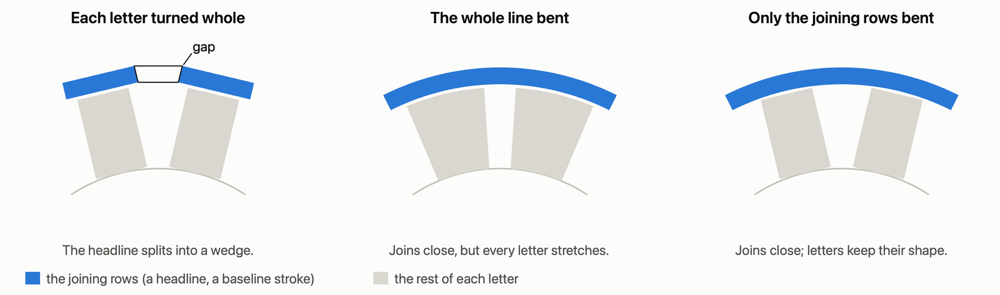
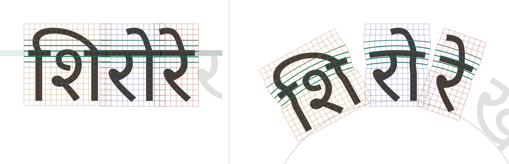

# How text_on_path works

Text-on-path packages turn each glyph, or each character, whole to the curve. A joining stroke runs from one letter into
the next. So when the two letters turn by different angles, the stroke splits: a gap on the outside of a bend, an
overlap on the inside. Bending the whole run instead keeps joins closed, but stretches every letter on the outside of a
bend and squashes it on the inside. text_on_path keeps letters rigid and bends only the rows they join on.

1. **Shape once.** Flutter's paragraph engine shapes the whole run, so every script comes out right: Arabic joining
   forms, Indic conjuncts and vowel signs, Nastaliq's slope.
2. **Draw each cluster alone.** Each grapheme cluster is drawn with the rest of the run transparent, so it keeps its
   exact shape and place, overhanging tails and all.
3. **Find the joining rows.** Wherever ink crosses the boundary between two clusters, that's a join. The rows that most
   joins cross are the script's connection line: the Arabic baseline stroke, or the Indic headline.
4. **Bend only those rows.** Each cluster is a triangle mesh, drawn with `Canvas.drawVertices`. Points in the joining
   rows follow the curve, and points away from them stay rigid with their letter. One eases into the other over
   0.18 em.
5. **Draw joins out, or pull them shut.** Where rigid letters land apart along the curve, a flat join is drawn out with
   its own cross-section, as a tatweel would be. A sloping one is pulled shut instead, the pull fading out over 0.3 em.

*Three Devanagari clusters, flat (left) and on a tight circle (right). The joining rows (teal) bend with the curve and
run on from cluster to cluster. The rest of each cluster's grid stays straight and turns whole.*

## Selection

A pointer is carried back to the straight line the text was shaped as, and the paragraph finds the position there. That
way right-to-left text, clusters and words come out right. The highlight bends with the curve, and the handles turn
with it.

## How well it works

All at 48 px, on a circle of radius 3 em, letters facing out. Both measures are taken through the mesh as drawn:
- **Joins:** the area, in px², between where one cluster puts a join's boundary and where its neighbour puts it,
  summed over the phrase.
- **Distortion:** how far ink moved from the nearest rigid placement of its letter, RMS, in px.

| Sample | Joins, rigid | Joins, text_on_path | Distortion, plain warp | Distortion, text_on_path |
|---|---:|---:|---:|---:|
| Arabic (Noto Naskh Arabic) | 13 | 0 | 0.43 | 0.22 |
| Persian (Noto Naskh Arabic) | 7.8 | 0 | 0.29 | 0.18 |
| Urdu (Noto Nastaliq Urdu) | 62 | 0.1 | 1.32 | 0.43 |
| Hindi (Noto Sans Devanagari) | 135 | 0 | 1.51 | 0.28 |
| Bengali (Noto Sans Bengali) | 92 | 0 | 2.06 | 0.44 |
| Latin script (Dancing Script) | 51 | 0.1 | 0.49 | 0.18 |

The inside of a bend, an S-curve and seals are in [measurements.md](measurements.md); sharpness is in
[sharpness.md](sharpness.md).

## Limits

- **Length inside a bend.** Letters are spaced along whichever is nearer the inside, the baseline or the joining rows,
  so joins are never squeezed. For the Indic headline, well above the baseline, that makes Hindi and Bengali about a
  quarter longer inside a circle of radius 3 em.
- **Traced outlines.** Flutter doesn't hand back glyph outlines, so `TextOutlines` traces them from a fine raster. They
  come within a few hundredths of a pixel of the font's edges at the text's size, but as polygons, not the font's own
  curves.
- **Kashida.** It draws a join out with the stroke's own cross-section, rather than inserting U+0640 and shaping again.
  A font's special kashida forms don't appear.
- **Joining rows.** They're found from the run's pixels; `connection: ConnectionLine.between(...)` sets them by hand.

To use it, see [Getting started](getting_started.md).
