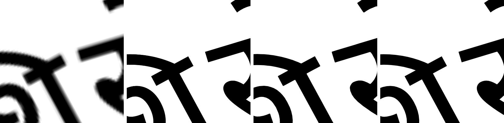

# Sharpness

Written by `flutter test tool/sharpness_test.dart`.

The text is shaped by Flutter's paragraph engine and drawn into an atlas, one cluster at a time; the mesh samples that raster. So `TextOnPath` keeps it sharp two ways: it draws the atlas again for the scale the text is shown at (the zoom of every transform above it, times the screen's pixel ratio), and past a memory budget it draws traced outlines instead.

Each measurement draws a window round one join of a Hindi phrase at 32 px, placed rigidly on a circle of radius 4 em: rigid, so the same letters can also be drawn natively, as vectors, under exactly the same rotation. A cell gives the drawn edges' width against native ones (pixels neither clear nor solid, as a ratio: 1× matches native, above is softer, below is harder, that is aliased) and, in brackets, the mean difference from native as a share of the ink.

## What `TextOnPath` draws

Zoom in screen pixels to each logical pixel (a screen at device pixel ratio 2 doubles it). *One atlas* is `TextOnPathRendering.raster`: two texels a pixel, drawn once. *Auto* is the default: an atlas drawn again at two texels a screen pixel (rounded up to a power of √2), or outlines once that atlas would pass 16 M texels (64 MB). *Outlines* is `TextOnPathRendering.vector`.

| Zoom | One atlas | Auto | Outlines |
|---|---:|---:|---:|
| 0.5× | 0.45× (20%) | 0.91× (13%), atlas 1.0 texel/px, 0.0 MB | 1.08× (14%) |
| 1× | 0.91× (11%) | 0.91× (11%), atlas 2.0 texel/px, 0.1 MB | 1.01× (13%) |
| 2× | 1.77× (12%) | 0.86× (8%), atlas 4 texel/px, 0.3 MB | 1.06× (10%) |
| 4× | 3.51× (17%) | 0.85× (5%), atlas 8 texel/px, 1.3 MB | 1.01× (5%) |
| 8× | 6.91× (20%) | 0.80× (4%), atlas 16 texel/px, 5.1 MB | 0.98× (3%) |
| 16× | 14.17× (24%) | 0.85× (0%), atlas 32 texel/px, 20.2 MB | 1.01× (3%) |
| 32× | 28.08× (24%) | 0.99× (3%), outlines | 0.99× (3%) |

*At 16× zoom, left to right: one atlas, the atlas drawn again for the zoom, traced outlines, and native text. (Rigid placement, so the native text can be drawn the same way; hence the opening in the headline.)*

## One atlas, magnified

*Texel/px* is atlas texels per logical pixel.

| Zoom | Atlas 1 texel/px | Atlas 2 texel/px | Atlas 4 texel/px | Atlas 8 texel/px |
|---|---:|---:|---:|---:|
| 1× | 1.76× (17%) | 0.91× (11%) | 0.42× (13%) | 0.22× (17%) |
| 2× | 3.49× (24%) | 1.77× (12%) | 0.86× (8%) | 0.44× (11%) |
| 4× | 6.93× (30%) | 3.51× (17%) | 1.73× (4%) | 0.85× (5%) |
| 8× | 13.57× (34%) | 6.91× (20%) | 3.38× (6%) | 1.69× (3%) |

- **Zooming past the atlas.** Edges match native best at about two atlas texels per screen pixel. At one texel per pixel they come out about 1.7 times as wide, and every further doubling of the zoom doubles them again. Drawing the atlas again for the zoom fixes it, at a cost in memory that grows with the square of the zoom: the atlas cells are cropped to each cluster's ink, which keeps it to a few MB up to about 8×.
- **Zooming out past it.** With many texels to each pixel and no mip levels, edges turn hard and jagged: 8 texels per pixel at 1× gives edges a fifth as wide as native. Auto draws a coarser atlas when zoomed out, too.
- **Where the mesh stretches.** Stretching spreads the same texels over more pixels. Plain warp stretches every letter on the outside of a bend by 1 + height × curvature: the top of a Devanagari letter on a 3 em circle by about a quarter. Joined placement keeps letters rigid; only the joining rows bend (stretched by about 1%), and a widened join is bridged by repeating the stroke's cross-section along the curve, so it doesn't soften across the stroke.
- **Turning it at all.** Even at two texels per pixel, sampling a turned raster differs by 5–10% from glyphs rasterised in place: a little softer and heavier at the edges.

## Outlines

Flutter doesn't hand back glyph outlines from a paragraph, and shaping outside it (HarfBuzz and a font parser) would mean a second shaper to keep in step with the first. So `TextOutlines.trace` traces them: each cluster drawn alone at 8 texels per logical pixel, its edge (where coverage crosses one half) followed by marching squares and simplified to within 0.02 px. That takes tens of milliseconds for a phrase and gives about a thousand points. The same mapping as the mesh carries each point onto the curve, with edges cut to a pixel first so they bend with it; a bridge is the stroke's cross-section, read off the outline, swept along the curve.

They make `TextOnPathPlacement.toSvg` and `toPdf` possible, and stay sharp at any zoom. The edges are the font's own to a few hundredths of a pixel at the text's size, so at very high zoom (past about 30×) the polygon behind a curve starts to show; tracing at a higher density pushes that further. They aren't the font's exact Bézier curves, and hinting and the text renderer's own antialiasing tweaks are gone.

